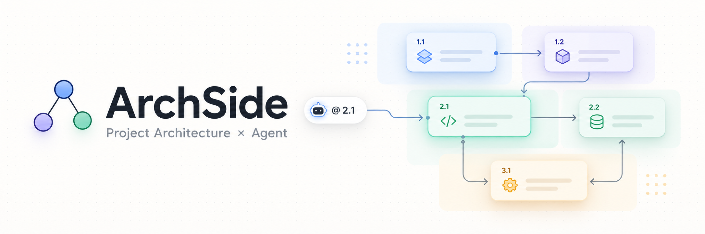
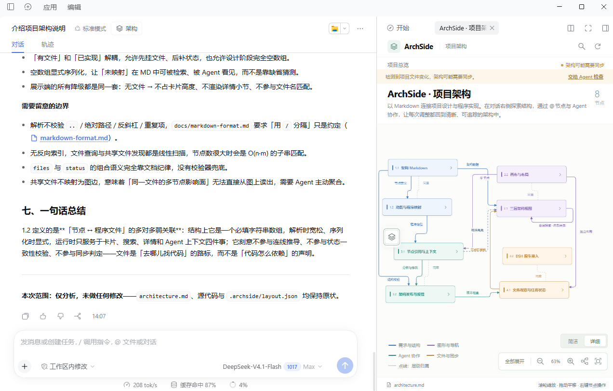
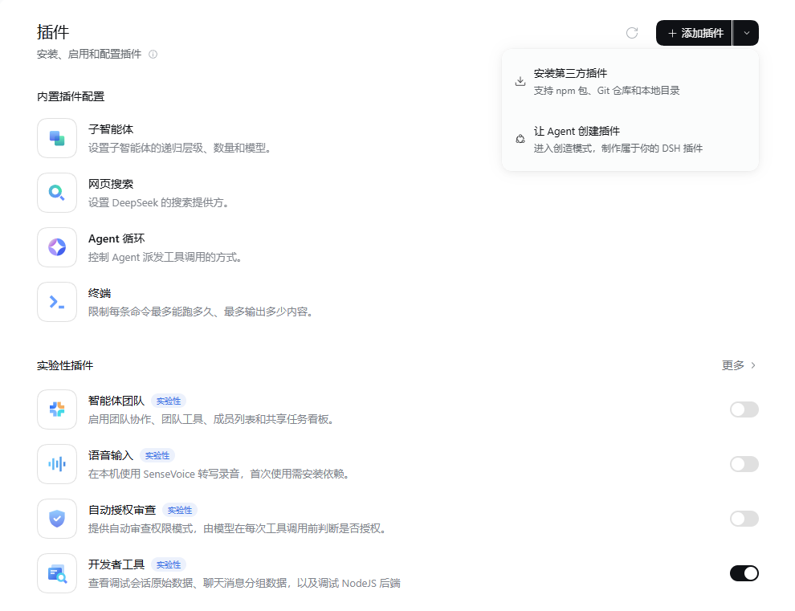

[中文](README.md) | [English](README.en.md)



# ArchSide

**Find the architecture in the graph. Work on it with your Agent in chat.**

ArchSide is a general-purpose project architecture sidebar plugin for **DeepSeek Harness**. It keeps native Agent chat on the left and an explorable architecture graph on the right. One `architecture.md` connects requirements, structural design, and implementation.

Version **0.1.4** targets **DSH Desktop 0.2.1-rc.2**. It supports existing codebases and projects still at the design stage, without depending on a particular domain or programming language.

## Preview



*Actual desktop screenshot. Explore the graph, select a node, and use chat to analyze it, revise the design, or change the implementation. The cover is a conceptual illustration; this screenshot shows the actual interface.*

## Features

- **Explore three levels:** project overview → complete chapter structure → node details. Switch between compact and detailed overviews.
- **Reference nodes in chat:** use `>` or the context menu to select `@`. Add one or more references to the native composer, write your instruction, then send.
- **Start from code or requirements:** ask the Agent to scan a codebase and draft the MD, or design an architecture before implementation exists.
- **Keep the graph and MD connected:** headings define chapters, sections, and subsections. Stable IDs preserve relationships when names or display numbers change.
- **Arrange freely, preserve relationships:** nodes from the same chapter stay near each other, using shared colors without enclosing boxes. Thin rounded routes avoid cards; original relationships remain individually visible. Dotted lines indicate hierarchy.
- **Navigate and inspect:** drag nodes, pan, zoom, fit the canvas, expand/collapse explanations, and search node names, files, or descriptive text.
- **Refresh after tasks finish:** preserve the graph during Agent work. External file changes prompt a sync review; publishing checks revisions and saves history.

### Three levels

| Level | Content | Typical use |
| --- | --- | --- |
| Project overview | Chapters in compact mode; sections in detailed mode, without chapter cards or enclosing boxes | Understand the system and choose a module |
| Chapter structure | All sections and subsections in that chapter, plus direct cross-chapter references | Inspect inputs, processing, outputs, and dependencies |
| Node details | Read-only Markdown with explanations, specifications, tables, code, and project images | Read the details and request changes through `@` |

Opening `1.2` from the overview enters chapter 1 and highlights `1.2`. Cross-chapter references navigate to their owning chapters. Expanding an explanation keeps the current level; opening a node enters the next level.

## Install and open

### Option 1: Ask the Agent to install it

Switch to **Creator mode (创造模式)** in DSH and give the Agent this project's GitHub URL, a downloaded package, or a local project path. For example:

> Please install ArchSide from: [repository URL / package URL / local path]. Follow the project's README. If the source is a checkout, build and package it first, then install through DSH's built-in plugin manager. Tell me whether a restart is required and how to open the architecture panel.

Complete the installation confirmations shown by DSH. If a restart is requested, save your work and reopen DSH.

### Option 2: Use the desktop Plugins page

1. Open **Plugins (插件)** in DSH's left sidebar.
2. Click **Add plugin (添加插件)**, or use its dropdown and choose **Install third-party plugin (安装第三方插件)**.
3. Enter the absolute path to an ArchSide `.tgz` package, a package download URL, or a **previously built local project directory**, then install.
4. Follow the page's instructions to finish installation and enable the plugin. Save your work and restart DSH if requested.

<details>
<summary>View the desktop installation entry</summary>



</details>

The page also accepts npm package names and Git URLs. For GitHub source, let the Agent build it or generate a package using the steps below. Installing by npm package name requires publishing to npm first. When a Release package is available, its download URL can be used directly.

### Option 3: Install manually from source

1. Download or clone this repository and open PowerShell in its root directory.
2. Save ongoing DSH work and **fully quit DSH**, including the tray process.
3. Install dependencies and run the installer, replacing the path with your DSH installation directory:

```powershell
npm.cmd ci
npm.cmd run install:desktop -- -DesktopDirectory 'C:\Path\To\DeepSeek Harness'
```

The script checks the host version and running processes, builds and packages the plugin, backs up the desktop profile manifest and lockfile, and installs through the **CLI bundled with DSH Desktop**. Backups stay in local `artifacts/`. The installer does not terminate user processes.

4. Reopen DSH after installation.

### Open ArchSide

Enter an established project conversation and click **架构 (Architecture)** in the conversation header to open ArchSide on the right. The new-session landing page may not expose the button until a conversation has been created.

An existing ArchSide-format `architecture.md` loads automatically. Otherwise, choose the Agent generation action, add your requirements, and send. Reinstall after source changes; the desktop plugin does not hot-reload source files.

<details>
<summary>Manual packaging, installation, and removal</summary>

```powershell
npm.cmd run pack:plugin
& 'C:\Path\To\DeepSeek Harness\resources\runtime\cli\bin\dsh.cmd' plugin --profile desktop add 'C:\Path\To\ArchSide\dsh-plugin-archside-0.1.4.tgz'
```

To remove the plugin, fully quit DSH first, then run:

```powershell
& 'C:\Path\To\DeepSeek Harness\resources\runtime\cli\bin\dsh.cmd' plugin --profile desktop remove dsh-plugin-archside
```

Use the bundled desktop CLI for the desktop profile. See the [DSH Desktop documentation](https://github.com/deepseek-ai/deepseek-harness/blob/master/apps/desktop/README.md) for host installation details.

</details>

## Working with the Agent

Select `@` from a node's menu, add an instruction, and send. For example, using nodes from the included Chinese demo:

> @(1.2 功能与程序映射) Analyze this component's responsibilities and dependencies. Update the architecture design only.

> @(2.2 画布与布局) Add layout restoration. Update both the implementation and the architecture documentation.

You can also ask where a piece of code belongs in the graph. The Agent can open the relevant chapter and highlight its node.

A reference identifies the intended subject; your instruction and dependencies determine the actual scope. The plugin exposes `archside_read`, `archside_context`, `archside_publish`, and `archside_focus`. The Agent analyzes and edits code, then publishes the architecture. Its response should state whether it changed **architecture only, architecture and code, code only, or performed analysis only**. Execution depends on the model and host tool permissions.

## Markdown and data

Each project uses one UTF-8 `architecture.md`. For example:

```markdown
# Image processing project

Accept images, preprocess them, and produce model outputs.

## 1 Input and preprocessing
<!-- archside: {"id":"input","color":"blue","status":"planned","files":[]} -->

### 1.1 Image input
<!-- archside: {"id":"image-input","status":"planned","files":[]} -->

#### 1.1.1 Format validation
<!-- archside: {"id":"validation","status":"planned","files":[]} -->
```

Numbering supports up to three levels; parents must appear first, and numbers and IDs must be unique. Preserve `id` when renaming or renumbering a node; use a new ID for a new function. Supported `color` values are `blue`, `purple`, `teal`, `orange`, and `slate`; `status` is `planned`, `implemented`, or `unknown`. `files` holds project-relative paths, and `summary` provides a short explanation. The node body contains its full details.

Declare relationships in a single `archside` code block, using stable IDs for endpoints:

```archside
{"version":1,"edges":[{"id":"input-validation","source":"image-input","target":"validation","label":"Image to validate","kind":"data"}]}
```

Each edge needs a unique `id`; `kind` supports `data`, `dependency`, and `optional`. Cross-chapter connections are allowed. Handle related edges when deleting a node. See the complete [example](examples/architecture.md), currently in Chinese. Markdown must follow the ArchSide format to become an architecture graph.

| File | Purpose |
| --- | --- |
| `architecture.md` | Architecture, explanations, node metadata, and relationships; intended for version control |
| `.archside/layout.json` | Local node positions and viewport, separate from architecture content |
| `.archside/history/` | Architecture backups created before plugin publishing |

Original relationships are preserved individually. Relationships collapsed inside one visible node appear as loops; hidden-chapter projections are labeled as chapter-level relationships. Pale dotted lines without arrowheads indicate hierarchy and do not add business relationships to the MD. Complex graphs may still contain crossings. External code changes need Agent review before synchronization; layout saves from multiple windows use the last write.

Project images support PNG/JPEG/WebP/GIF up to 4 MB; Markdown HTML is not executed. Node reference mappings live in the current running session. After a restart, reselect nodes or use stable IDs to verify old display numbers in chat history.

## Development and validation

```powershell
npm.cmd ci
npm.cmd run build
npm.cmd run dev
```

Open <http://127.0.0.1:4173>. The preview reads the current directory's `architecture.md`; its left-hand draft area is not connected to a model. Validate actual Agent collaboration inside DSH. Set `ARCHSIDE_PREVIEW_WORKSPACE` to use another workspace.This address points to the local machine running the preview service and is not an online demo address. Users who have only installed and used the plugin can skip this section.

```powershell
npm.cmd run check
npm.cmd run test:ui
npm.cmd run pack:plugin
```

`check` runs type checking, automated tests, and the build. UI tests and package-entry validation use locally installed **Google Chrome**. UI tests use a temporary workspace and save screenshots to `artifacts/`. There are currently 30 automated tests covering MD, stable relationships, layout, routing, storage, and DSH integration.

| Directory | Responsibility |
| --- | --- |
| `src/core/` | Models, MD parsing, graph projection, layout, and routing |
| `src/client/` | Three-level panel, DSH sidebar, and composer integration |
| `src/host/` | Workspace files, task state, Agent tools, and gateway |
| `src/preview/` | Local development preview |
| `tests/`, `scripts/` | Tests, build, packaging, and desktop installation |

The package currently declares `UNLICENSED`; an open-source license has not yet been selected.
